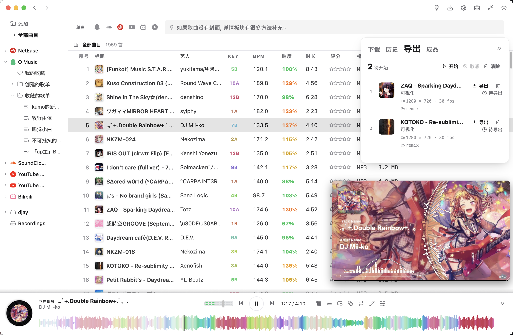

<div align="center">
  <p>
    
  </p>

  <h1>
    Kumo's<br>
    <em>Download &amp; Jockey</em>
  </h1>

  <p>
    
    <a href="https://github.com/kumoSleeping/KDJ/releases/latest"></a>
    
    
    
  </p>

  <br>

  
</div>

---

[中文](README.md) · **English**

## Get the app

Choose your platform below to download the latest installer. The macOS button defaults to Apple Silicon (M-series); Intel Mac users can select the x64 DMG from the latest [Releases](https://github.com/kumoSleeping/KDJ/releases/latest).

<!-- release-package-size-badges:start -->
<p>
  <a href="https://github.com/kumoSleeping/KDJ/releases/download/v1.1.0-rc19/KDJ_1.1.0-rc19_aarch64.dmg"></a>
  <a href="https://github.com/kumoSleeping/KDJ/releases/download/v1.1.0-rc19/KDJ_1.1.0-rc19_x64-setup.exe"></a>
  <a href="https://github.com/kumoSleeping/KDJ/releases/download/v1.1.0-rc19/KDJ_1.1.0-rc19_amd64.deb"></a>
  <a href="https://github.com/kumoSleeping/KDJ/releases/download/v1.1.0-rc19/app-arm64-release.apk"></a>
  <a href="https://github.com/kumoSleeping/KDJ/releases"></a>
</p>
<!-- release-package-size-badges:end -->

You may need to allow apps from unidentified developers. On macOS, allow the app under System Settings → Privacy & Security → General.

Desktop builds check for updates when GitHub is reachable, with a manual check in Settings. On Android, install the arm64 APK; installing a newer version over it preserves your data.

KDJ packs cross-platform search, download, local library management, and music analysis into one app. Instead of jumping between websites, downloaders, and tagging tools, preparing music can stay one continuous workflow.

## Features

- Search and download
  - Aggregate search across NetEase, QQ Music, SoundCloud, YouTube Music, YouTube and Bilibili; switch between songs, playlists, artists, albums and podcasts and open the related content
  - Drag a platform icon to set source priority; turn off unused platforms in Settings
  - Account login, deduplicated merged results, and track / playlist link parsing (paste several links to batch them)
  - In-app preview with quality fallback, and downloading the playing online song from the player
  - Right-click "add to download queue" or drag songs into the queue; per-song quality and save location, batch start and retry, and a history page
  - Right-click to share a song, with its details and a small cover
- Library and analysis
  - Local folder scanning, tag editing, star ratings and cover management; drag local songs out of the app like files
  - Automatic BPM, key and loudness analysis, with a choice of key notation; light / full / paused analysis modes that give way to playback
  - Library optimisation finds duplicate songs; multi-select copy with undo
  - A colour waveform in the player bar, generated progressively for online songs
- Song visualizer
  - A moving picture for any local song: cover, title and artist, spectrum and waveform
  - Previewed live in a floating window you can move and resize, with an export key at its bottom right
  - A configuration drawer with Scene, Pictures, Text and Output pages
  - Right-click "export visualizer" or drag local songs into the export queue; finished videos appear under Finished. Exports use the system's own video encoder; where there is none (most of Linux, macOS 10.15) the export keys are greyed with the reason and the preview still works
- Playback
  - One playback flow for local and online songs, with an optional auto-advance
  - A standard player and a mini player that docks at a corner of the desktop above other windows
  - Video and visualizer floating windows that move and resize; a song shows the visualizer you tuned
  - Tempo, gain and a three-band EQ in the player bar; elapsed or remaining time
  - Customisable arrow keys and system media keys
  - Lyrics with word-by-word timing, translation and romanisation, and a desktop lyrics overlay
  - VJ editing (the mixing editor) and VJ output from the toolbox
- Other
  - Light / dark / system theme
  - A bulb in the top bar teaches search, sidebar, download, visualizer and player with small animations
  - Lightweight Tauri desktop app; Android supported; automatic update checks on launch

> [!NOTE]
> KDJ does not use FFmpeg. Downloads, playback and visualizer export use pure Rust and the system's own decoders and encoders; what a system cannot do is listed in [Known limitations](docs/known-limitations.md).

### Android

- Android 8+ on arm64 devices; YouTube playback needs Android 9+ and a current Android System WebView.
- Music search/download, library, analysis, waveforms, lyrics, themes and system media controls; overlay lyrics and video picture-in-picture.
- No visualizer production. Video formats depend on system support.
- See [Android](docs/android.md) for adaptation details and device acceptance checks.

## Build for development

Requires Node.js 20+, Rust 1.93+ (the repository pins 1.93.0), and the matching [Tauri 2 prerequisites](https://v2.tauri.app/start/prerequisites/).

```bash
git clone https://github.com/kumoSleeping/KDJ.git
cd KDJ
npm install
npm run dev
```

Common commands:

```bash
npm run typecheck        # frontend typecheck
npm run tauri:web:build # build frontend
npm run build            # package the desktop app
```

KDJ uses React 19 for the UI, Rust for library, analysis, download, and playback, and Tauri 2 for the native desktop shell.

## Usage

KDJ provides media management and technical tools only. When using search, preview, and download features, follow local laws, platform terms, and copyright requirements.

## License

KDJ is released under [GNU GPL 3.0 or later](LICENSE). Release builds statically link the
GPL-2.0-or-later Rubber Band Library. Its corresponding source and license are kept in
[`crates/kdj-player/vendor/rubberband`](crates/kdj-player/vendor/rubberband); see
[`THIRD_PARTY_NOTICES.md`](THIRD_PARTY_NOTICES.md) for details.
